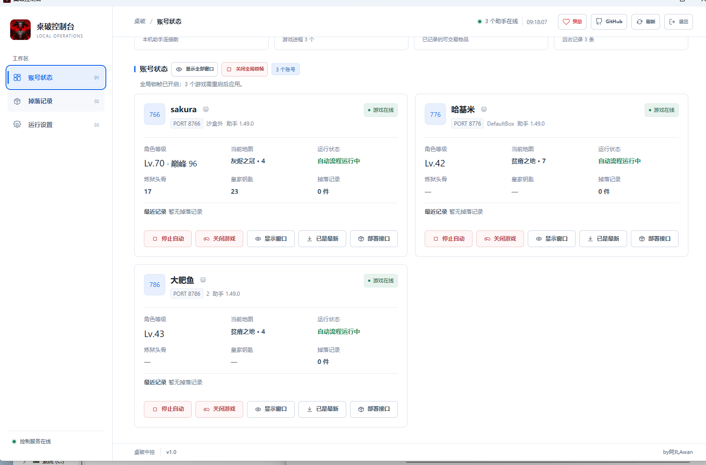
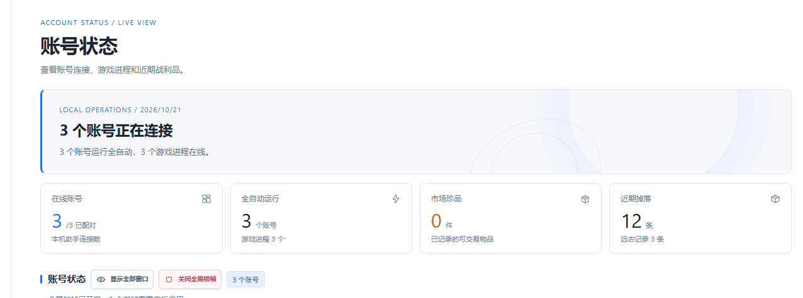
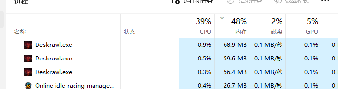

<p align="center">
  <a href="https://github.com/buguniaoOVO/deskrawl-hub-client/stargazers"></a>
  
</p>

# 桌破中控客户端

桌破中控客户端 1.0 使用 WinForms、WebView2 和内置运行模块，在桌面窗口中提供账号状态、掉落记录与运行设置。关闭窗口会将客户端缩小到任务栏；退出按钮会关闭客户端及其内置运行模块。

> **使用前请注意：本项目只提供桌面控制台，不包含 X1X 游戏助手本体或沙盒插件。** 包内运行模块只负责控制台本地服务。请先另行安装并运行 [X1X 助手](https://x1x.tw/deskrawl/helper/)，再用中控管理已连接的账号实例。

## 控制台页面介绍

账号状态页集中展示助手连接、游戏进程、自动流程、角色信息和掉落统计。标题旁可统一显示或隐藏游戏窗口、开启或关闭全局锁帧；运行设置提供 10 帧和 30 帧挡位，账号卡片提供单账号日常操作。

完整账号状态页面：



账号总览区域：



账号状态页提供全局锁帧和全部游戏窗口显隐按钮。全局锁帧会应用到已识别的 Deskrawl 游戏进程，并在新进程启动后自动应用；帧率挡位可在运行设置中选择 10 或 30 帧。

Sandboxie 会把游戏写出的状态文件放在各自沙盒目录。客户端会从这些目录读取状态，显示锁帧是否已应用。帧率设置只修改 Unity 的目标帧率和垂直同步，不会主动压缩游戏内存。

## 多开运行示例

任务管理器截图展示了三个同时运行的 `Deskrawl.exe` 实例。截图时分别显示约 68.9 MB、59.6 MB 和 56.4 MB 内存占用；实际数值会随游戏状态变化。



## 构建

在 Windows x64 安装 .NET 8 SDK 和 MinGW x64，然后运行：

```powershell
& .\publish.ps1
```

生成文件位于 `publish\桌破中控.exe`。客户端使用系统 Microsoft Edge WebView2 Runtime。

如需让发布脚本自动覆盖本机安装版本，请在仓库根目录创建被 Git 忽略的 `install-path.local.txt`，写入目标 exe 的绝对路径。

运行 `install.ps1` 可将发布文件复制到桌面，并把指定的旧桌面程序文件设为隐藏属性。详细部署说明见 [README-部署.md](README-部署.md)。

## 项目结构

- `MainForm.cs`：桌面窗口、运行模块启动和 WebView2 资源路由。
- `WebAssets/`：页面结构、样式和交互代码。
- `Assets/engine.payload.gz`：客户端内置运行模块。
- `FrameCapLivePlugin/`：游戏进程限帧组件源码。
- `Assets/demon-icon.png`：客户端图标源图。
- `publish.ps1`：生成 Windows x64 单文件客户端。
