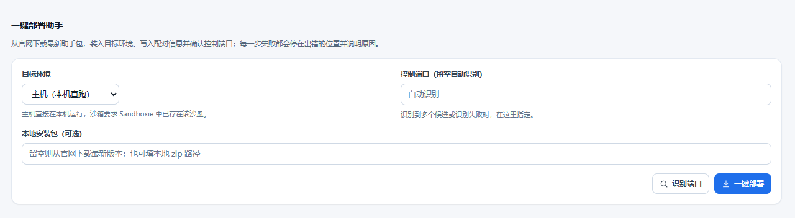
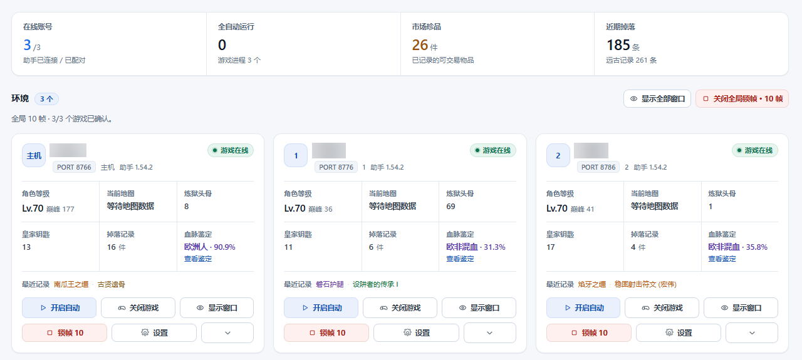
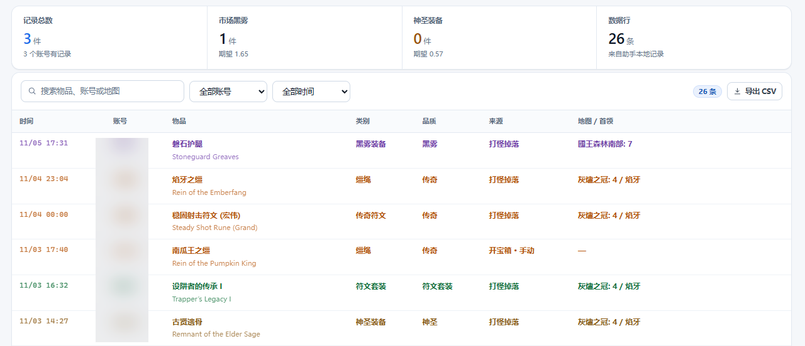
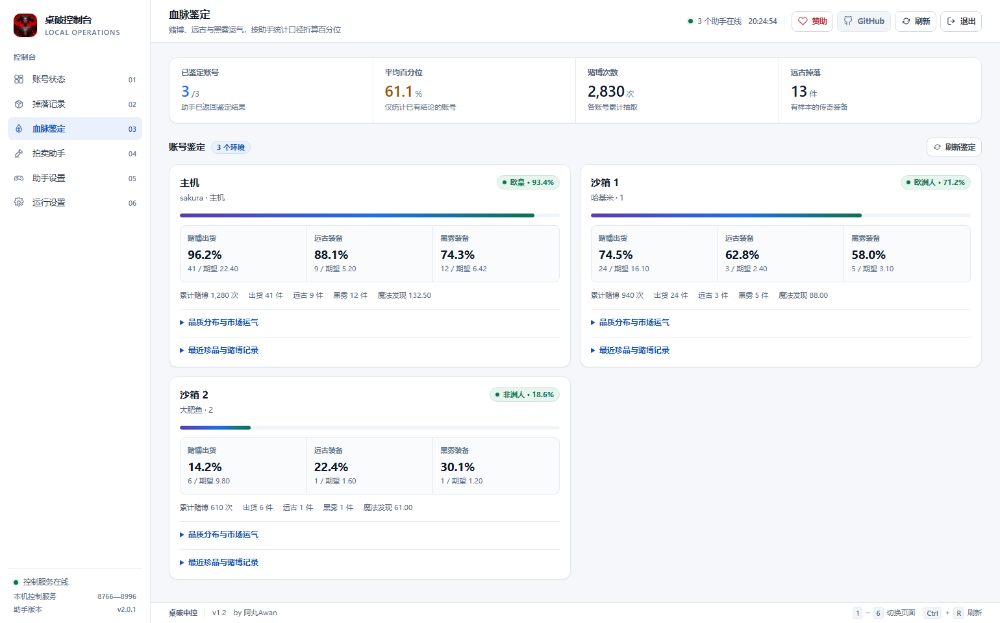
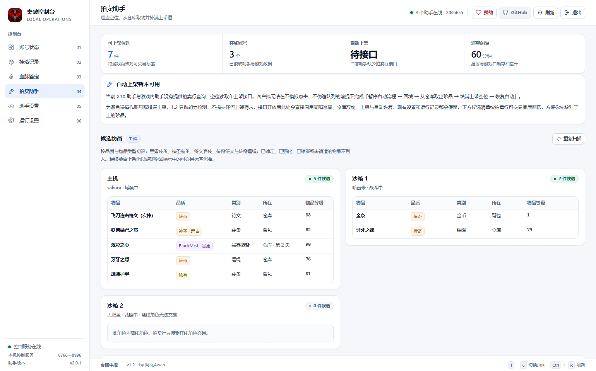
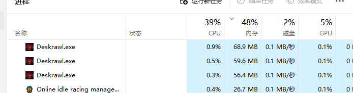

<p align="center">
  <a href="https://github.com/buguniaoOVO/deskrawl-hub-client/stargazers"></a>
  
</p>

# 桌破多开中控助手

桌破多开中控助手 1.3 使用 WinForms、WebView2 和内置运行模块，在桌面窗口中提供账号状态、掉落记录、血脉鉴定、拍卖助手、助手设置与运行设置。关闭窗口会将客户端缩小到任务栏；退出按钮会关闭客户端及其内置运行模块。

> **使用前请注意：本项目只提供桌面控制台，不包含 X1X 游戏助手本体或沙盒插件。** 助手本体由 [X1X](https://x1x.tw/deskrawl/helper/) 发布，中控可以自动下载并部署进主机或指定沙盘（也可以指定本地安装包/目录），也可以照旧为各环境选择已装好的助手目录。启动游戏可在助手离线时使用。

账号状态页的账号卡片展示助手血脉评定、百分位和有效样本；点击「查看鉴定」进入独立的血脉鉴定页。

## 主机与沙箱管理

- 账号状态页保留主机及各 Sandboxie 沙箱的卡片，游戏与助手均可分别启动。
- 「环境设置」保存该环境使用的助手目录、游戏路径和启动方式。Steam 方式通过目标环境的 Steam 启动；直接启动方式运行所选的 Deskrawl.exe。
- 「助手设置」在客户端中打开 X1X 官网的助手页面。主机与各沙箱使用独立的 WebView2 存储，打开页面前核对配对信息、控制端口及沙箱归属。
- 「浏览器打开」使用当前助手的完整配对链接，可重新连接浏览器页面。浏览器访问本机网络的权限仍由浏览器管理。
- 助手更新后，中控在原助手目录的同级目录查找配对信息一致的新版本；目录或配对信息存在歧义时，需要在环境设置中选择。
- 扫描到但不需要的沙箱，可用账号卡片右上角的 × 移出账号状态页；配置与配对信息保留，「助手设置 → 环境管理」可以逐个加回，也可以按 Sandboxie 沙盘名手动添加。
- 环境卡可以「检测端口」和「部署助手」：先探测本机候选控制端口（进程路径、沙盘归属、`/control/status`、配对文件四项证据均可复核，探测没通过的候选也会列出并标为未确认，支持手动指定端口），再一键把官方助手包下载、校验、解包、落位、配对并启动，进度按 9 个步骤逐步显示，失败会停在出错的那一步。部署时会从 8766–8876 的 12 组端口对里挑一组空闲的交给助手。
- 环境卡「⋯ → 更新助手」会走完一整条流程：停止全自动 → 关闭游戏 → 下载并安装助手 → 重新启动游戏，过程中逐步显示进度，失败会停在出错的那一步并说明原因。

「识别端口」与「一键部署」的实际界面：



账号环境保存在 LocalAppData 下的 DeskrawlHubClient/account-workspace.json。中控保持原助手的配对码，并通过 Sandboxie 的进程查询接口识别游戏与助手所属环境。内嵌的 X1X 官网页面需要联网。

## 控制台页面介绍

账号状态页顶部是一条指标带，汇总在线账号、全自动运行、市场珍品与近期掉落；「环境」一栏可统一显示或隐藏游戏窗口、开启或关闭全局锁帧，下方是各环境的卡片和最近 6 条掉落。运行设置提供 10 帧和 30 帧挡位。每张环境卡常驻「自动 / 游戏 / 窗口」三个操作，检查更新、部署接口、助手页面与环境设置收在右侧的「⋯」菜单里。

完整账号状态页面（截图里的账号昵称已打码）：



掉落记录页：整行按品质上色，类别与品质改为纯文字，不再套背景框。



账号状态页提供全局锁帧和全部游戏窗口显隐按钮。全局锁帧会应用到已识别的 Deskrawl 游戏进程，并在新进程启动后自动应用；帧率挡位可在运行设置中选择 10 或 30 帧。每张账号卡还能单独开关锁帧并各自选 10/30 帧，可同时锁多个账号，没单独设置的账号沿用全局；点全局开关会清空所有单账号设置并统一挡位（一键全开/全关）。

## 血脉鉴定

「血脉鉴定」页读取各环境助手的 `/control/lineage` 记录，逐账号列出赌博出货、远古装备与黑雾装备的百分位、期望值、品质分布、可交易珍品和最近记录。页面只做汇总展示，记录来源与概率口径由 X1X 助手计算。



## 拍卖助手

「拍卖助手」页扫描各账号背包与仓库，按拍卖行规则列出候选珍品：黑雾装备、神圣装备、符文套装、传奇符文与传奇缰绳，并排除已锁定、已强化、已镶嵌与未铸造的物品。

当前 X1X 助手与游戏内助手没有拍卖行查询、空位上架或仓库取出的操作接口，因此 1.3 只提供候选清单与流程说明，不会模拟点击或代替游戏提交上架。待助手开放对应接口后，才能在客户端接入「暂停自动流程 → 回城 → 从仓库取出珍品 → 上架空位 → 恢复自动」的完整流程。



Sandboxie 会把游戏写出的状态文件放在各自沙盒目录。客户端会从这些目录读取状态，显示锁帧是否已应用。帧率设置只修改 Unity 的目标帧率和垂直同步，不会主动压缩游戏内存。

## 多开运行示例

任务管理器截图展示了三个同时运行的 `Deskrawl.exe` 实例。截图时分别显示约 68.9 MB、59.6 MB 和 56.4 MB 内存占用；实际数值会随游戏状态变化。



## 构建

在 Windows x64 安装 .NET 8 SDK 和 MinGW x64，然后运行：

```powershell
& .\publish.ps1
```

生成文件位于 `publish\桌破中控.exe`。客户端使用系统 Microsoft Edge WebView2 Runtime。

如需让发布脚本自动覆盖本机安装版本，请在仓库根目录创建被 Git 忽略的 `install-path.local.txt`，写入目标 exe 的绝对路径。

运行 `install.ps1` 可将发布文件复制到桌面，并把指定的旧桌面程序文件设为隐藏属性。详细部署说明见 [README-部署.md](README-部署.md)。

## 项目结构

- `MainForm.cs`：桌面窗口、运行模块启动和 WebView2 资源路由。
- `WebAssets/`：页面结构、样式和交互代码。
- `Assets/engine.payload.gz`：客户端内置运行模块。
- `FrameCapLivePlugin/`：游戏进程限帧组件源码。
- `DeployManager.cs`：端口识别与一键部署助手。
- `Assets/demon-icon.png`：客户端图标源图。
- `publish.ps1`：生成 Windows x64 单文件客户端。

## 支持一下

如果这个项目用得上，点个 Star 就是最大的鼓励；也可以扫码请我喝瓶可乐。

<p align="center">
  <a href="https://github.com/buguniaoOVO/deskrawl-hub-client/stargazers"></a>
  
</p>